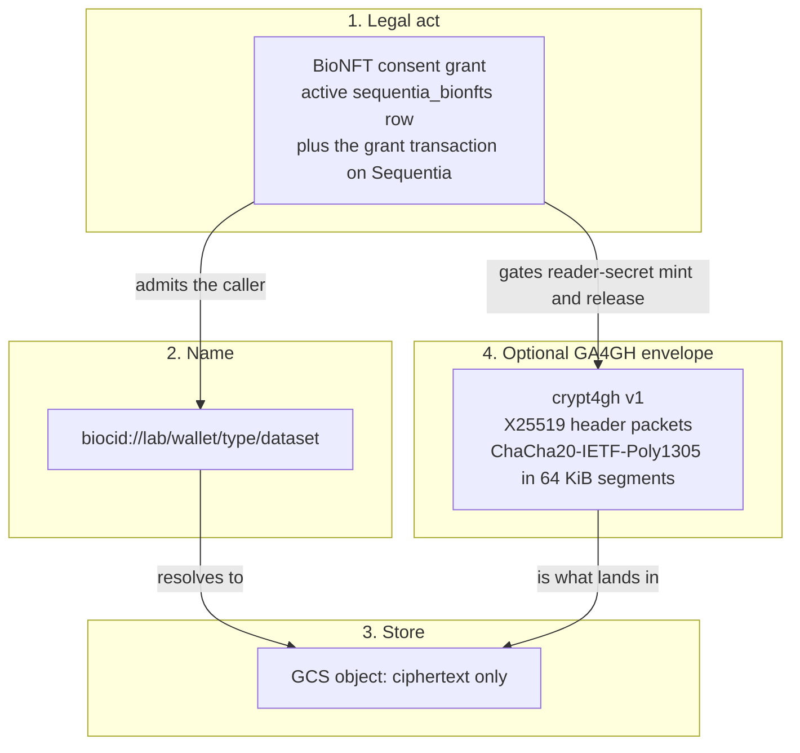
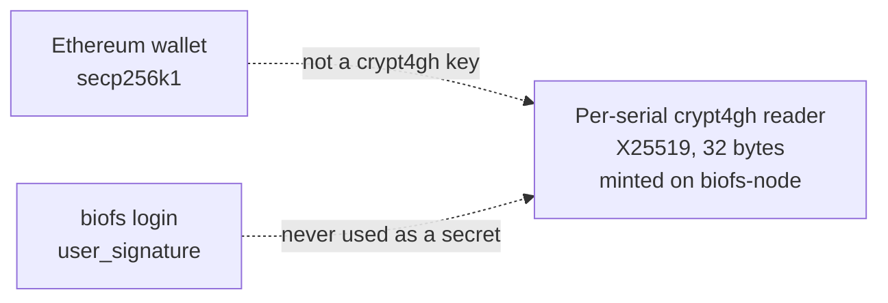
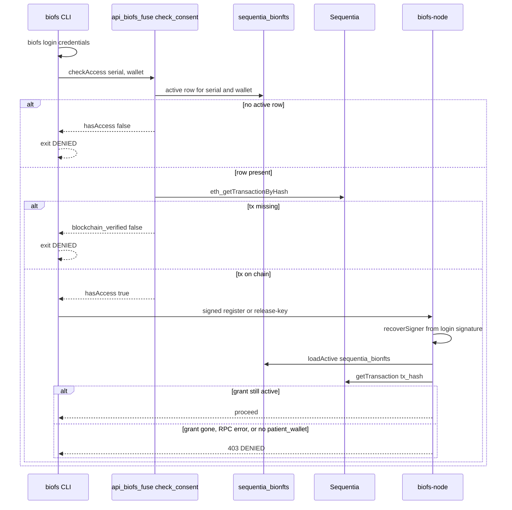
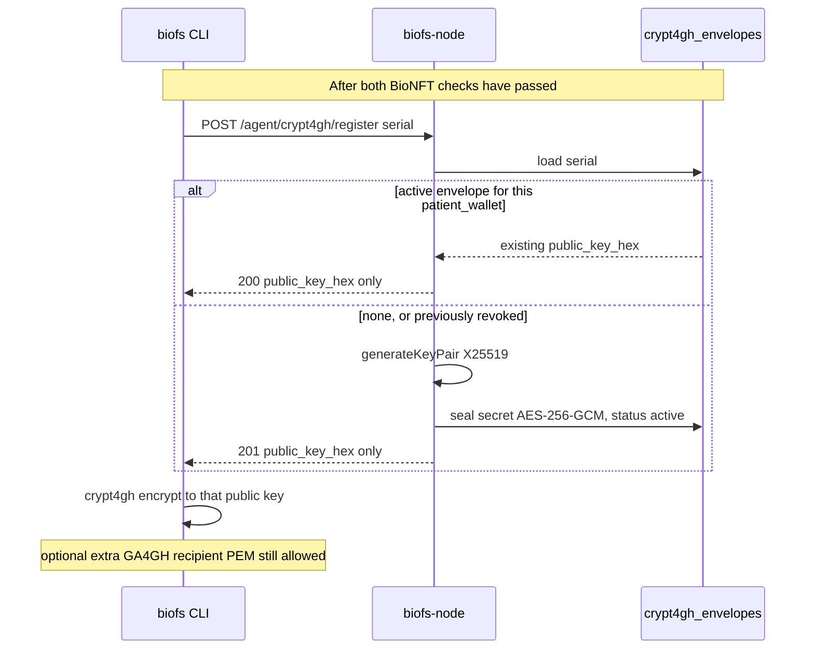
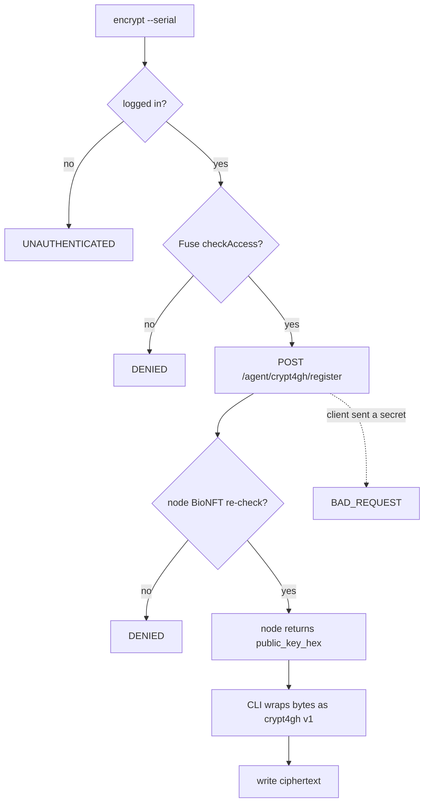
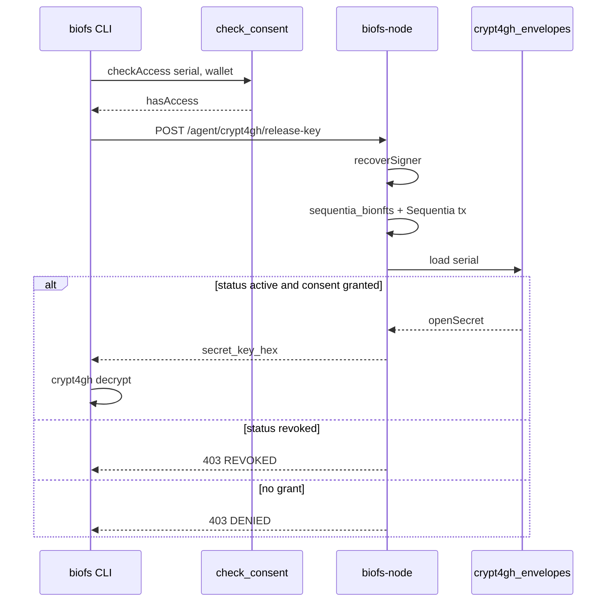
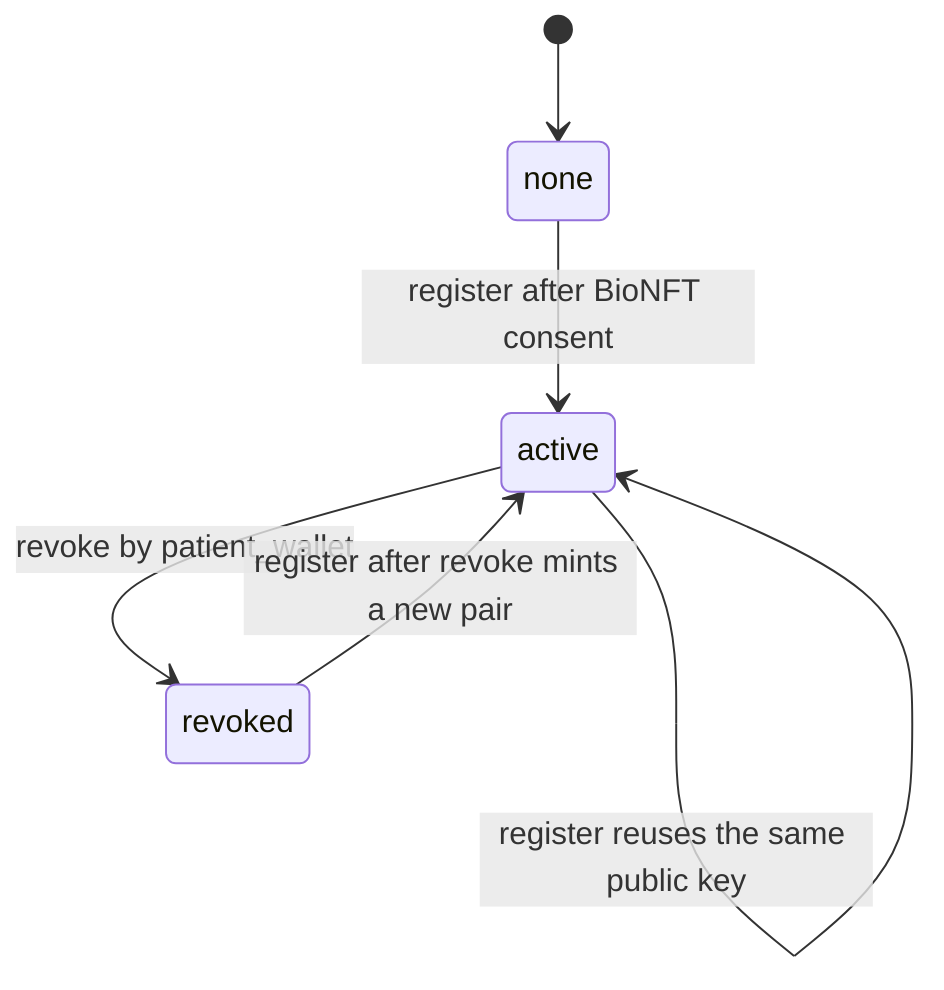
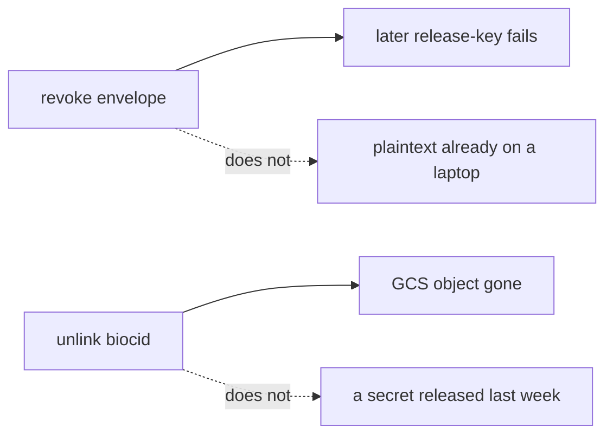

# BioNFT-gated crypt4gh in BioFS

GenoBank.io  
21 September 2026  
biofs-cli 3.22.0 · biofs-node 0.4.30

crypt4gh encrypts bytes. A BioNFT grants consent. BioFS keeps those as two different acts and then pairs them, so a GA4GH envelope cannot be minted or unwrapped without a living grant on the biosample serial.

This note is the protocol companion for that pairing. It is not a journal manuscript.

## How it complements BioFS

BioFS is already a legal-act filesystem. A biosample is named by a `biocid://`. Access is a BioNFT grant (Metamorphic Consent). Bytes live as ciphertext in GCS. Erasure is `unlink`. Streaming is htsget. Jobs (Clara, OpenCRAVAT, imaging) re-check consent on the node.

crypt4gh does not replace any of that. It is an optional GA4GH File Encryption Standard v1 envelope around object bytes so htslib and the EGA crypt4gh tool can read the same ciphertext BioFS stores. The envelope names a reader by a static X25519 public key baked at write time. That key is not consent, it cannot revoke, and it is not an Ethereum wallet.

BioFS therefore holds the X25519 secret on biofs-node, keyed by biosample serial, and releases it only while the BioNFT grant is active. The BioNFT remains the right. crypt4gh remains the codec. GCS remains the store. `biocid://` remains the name. `unlink` remains erasure.



Default vault objects are not bulk-converted. The 8,547-sample census is not crypt4gh. `biofs crypt4gh` and `biofs upload --envelope crypt4gh --serial` are opt-in.

## Three things that are never the reader secret

An Ethereum wallet is secp256k1. crypt4gh readers are X25519. Those curves do not convert. The BioFS login `user_signature` is a bearer over the GenoBank.io login message. It authenticates who is asking. It is never hashed, derived, or used as a crypt4gh secret.



The node mints the X25519 pair. The CLI never sends a reader secret at write time. Client-supplied `secret_key_hex` on `POST /agent/crypt4gh/register` is refused.

## Dual consent: the CLI does not get to be believed

`biofs crypt4gh encrypt --serial` and `decrypt --serial` call `BioNFTClient.checkAccess` first. That hits `GET /api_biofs_fuse/check_consent` with the biosample serial and the logged-in wallet. Fuse admits the call only when both of these hold:

1. An `active` row in `genobank-api.sequentia_bionfts` for that serial whose `agent_wallet` or `patient_wallet` matches the caller.
2. The row's `tx_hash` exists on Sequentia (`eth_getTransactionByHash`). A Mongo-only row is stale and is denied (`blockchain_verified` must be true).

biofs-node then re-reads the same collection and re-checks the same transaction. A forged CLI, a skipped client check, or a wallet header that does not recover from the login signature all fail closed on the node.



Envelope ownership is the BioNFT `patient_wallet`, not the agent who happened to encrypt. A grant with no `patient_wallet` cannot mint an envelope.

## Key exchange

One X25519 pair per biosample serial. Every crypt4gh object of that serial shares the reader. After revoke, `ensure` rotates: a new pair is minted so later objects are not readable with the old secret.

The secret is sealed at rest in `biofs_node.crypt4gh_envelopes` with the node's existing AES-256-GCM at-rest wrap (`enc:v1:`). Public facts (serial, public key, status, owner) can be read after consent. The secret leaves the node only on `POST /agent/crypt4gh/release-key`.



HTTP:

1. `POST /agent/crypt4gh/register` mints or reuses the pair. Public key out. Secret never out.
2. CLI encrypts plaintext to that public key. Extra `--recipient-pk` adds a second header packet for EGA-side readers.
3. Secret stays sealed in `biofs_node.crypt4gh_envelopes`.
4. `POST /agent/crypt4gh/release-key` unseals only while `status=active` and BioNFT consent still holds.
5. `biofs crypt4gh revoke --serial` (envelope owner = BioNFT `patient_wallet`) sets `status=revoked`. Later release fails.
6. Unbound EGA interop is only `--allow-unbound`. `biofs upload --envelope crypt4gh` requires `--serial`.

## Encrypt

```
biofs crypt4gh encrypt --serial 41221040804049 -i local.bin -o local.bin.c4gh
```



If register fails, the CLI does not write an unbound envelope. Fail closed.

`biofs upload --envelope crypt4gh --serial <biosample>` runs the same bound wrap before the upload.

## Decrypt

```
biofs crypt4gh decrypt --serial 41221040804049 -i local.bin.c4gh -o local.bin
```



## Revoke

```
biofs crypt4gh revoke --serial 41221040804049
```

Only the envelope owner (the BioNFT `patient_wallet`) may revoke. An authorized agent who can decrypt cannot revoke.



Revoke stops later hand-out. It does not recall plaintext. crypt4gh is a static envelope: a reader who already obtained the secret can still open those bytes. BioFS does not pretend otherwise. Erasure of the object bytes is still `biofs unlink` / GCS delete, which is a different plane from key release.



Those two planes together are how BioFS complements a GA4GH codec: crypt4gh talks to genomic tools; BioNFT and unlink talk to consent and erasure.

## Unbound EGA path

For synthetic bytes and EGA-tool interop with no BioNFT:

```
biofs crypt4gh encrypt --allow-unbound --recipient-pk recipient.pub -i in.bin -o out.c4gh
biofs crypt4gh decrypt --allow-unbound --sk recipient.sk -i out.c4gh -o out.bin
biofs crypt4gh keygen --out ~/.biofs/crypt4gh
```

Without `--allow-unbound`, encrypt and decrypt require `--serial`. `upload --envelope crypt4gh` has no unbound switch.

## What this does not do yet

Stream, view, and htsget serving paths do not auto-unwrap crypt4gh objects. The gated paths in 3.22.0 / 0.4.30 are register, release-key, revoke, CLI encrypt/decrypt, and upload wrap. `BIOFS_CRYPT4GH_SK` is no longer a serving unwrap.

Lit Protocol KEK release, described elsewhere as the default object-key wrap, is a separate plane. It is not this crypt4gh bind.

## Commands and routes

```
biofs crypt4gh encrypt --serial <biosample> -i <plain> -o <cipher>
biofs crypt4gh decrypt --serial <biosample> -i <cipher> -o <plain>
biofs crypt4gh revoke  --serial <biosample>
biofs crypt4gh inspect <file.c4gh>
biofs upload <file> --envelope crypt4gh --serial <biosample>
```

```
POST /agent/crypt4gh/register
POST /agent/crypt4gh/release-key
POST /agent/crypt4gh/revoke
GET  /agent/crypt4gh/envelope?serial=
GET  /agent/crypt4gh/status
```
